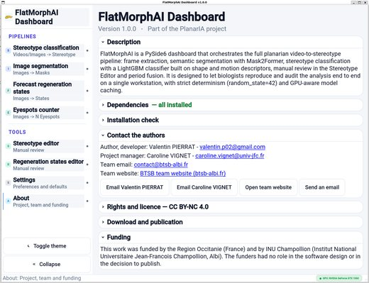
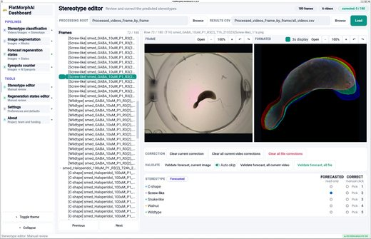
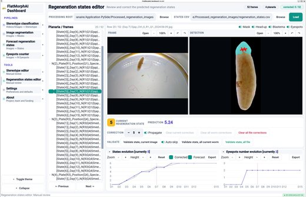

# FlatMorphAI

FlatMorphAI is a desktop application for the automated analysis of planarians
from video and still images. It segments the worm with a fine-tuned Mask2Former,
locates the head, the blastema and the eyespots, measures shape, texture and
motion descriptors along the body axis, and from them forecasts the behavioural
**stereotype** of each video frame and the **regeneration state** of each head.
Every forecast can be reviewed and corrected in a dedicated editor, and every
result can be recomputed and compared with the reference tables shipped here.

Version 1.0.0 — part of the PlanarIA project, BTSB, INU Champollion, Albi, France.

<table>
  <tr>
    <td align="center" valign="top" width="33%">
      <a href="docs/screenshots/01_about.jpg"></a><br>
      <sub><b>Dashboard</b><br>the processing chains and the tools</sub>
    </td>
    <td align="center" valign="top" width="33%">
      <a href="docs/screenshots/02_stereotype_editor.jpg"></a><br>
      <sub><b>Stereotype editor</b><br>review and correct each forecast</sub>
    </td>
    <td align="center" valign="top" width="33%">
      <a href="docs/screenshots/03_regeneration_editor.jpg"></a><br>
      <sub><b>Regeneration states editor</b><br>detections and the day-by-day curve</sub>
    </td>
  </tr>
</table>

<sub>Click a thumbnail to see the full-size screenshot.</sub>

### What the application does

| Page | Input → output |
|---|---|
| **Stereotype classification** | videos (or already-extracted frames) → one of five stereotypes per frame (C-shape, Screw-like, Snake-like, Walnut, Wildtype), then periods per video |
| **Image segmentation** | images → worm masks |
| **Forecast regeneration states** | photographs of regenerating worms → regeneration state, head position, blastema and eyespot detections |
| **Eyespots counter** | images → number of eyespots |
| **Stereotype editor** | manual review and correction of the stereotype forecasts |
| **Regeneration states editor** | manual review and correction of the regeneration states |

---

## 1. Hardware

The reference configuration, on which every published number was measured:

* NVIDIA GPU with **6 GB** of memory (GeForce GTX 1060 6 GB), 8 GB of RAM,
  4 physical cores;
* Windows with **WSL 2**, the application running inside the Linux distribution.

Measured durations on that machine:

* **Stereotype classification**, the 6 shipped videos (180 frames): about
  9 and a half minutes, from the videos to the periods table;
* **Forecast regeneration states**, the 52 shipped images: about 72 seconds.

A smaller GPU works: the memory planner reduces the batch sizes and the number
of concurrent workers. The run is slower; the results do not change.

---

## 2. Installation

Python **3.10**. Run every command below **from the root of this repository**:
the default data folders and the scripts are relative to it.

**On Windows, two ways.** WSL 2 (the Linux subsystem of Windows) is the
configuration the published results were validated with: the step-by-step
guide is in *WSL 2* below. The application also runs natively under Windows
with conda (*Windows (native)* at the end of this section); that configuration
is newer, so check it once with the two comparisons of section 6.

### Linux (native CUDA)

```bash
conda env create -f environment.yml
conda activate flatmorphai

# 1. torch FIRST, from the index matching your CUDA version
python -m pip install torch==2.5.1 torchvision==0.20.1 \
    --index-url https://download.pytorch.org/whl/cu121

# 2. everything else, at the validated versions
python -m pip install -r requirements.txt

# 3. the model weights (section 3)
python scripts/download_models.py

# 4. check the installation (section 4), then launch
python -m flatmorphai.install_check
python -m flatmorphai
```

Without conda, any Python 3.10 virtual environment does the same job:
`python3.10 -m venv .venv && source .venv/bin/activate`, then steps 1 to 4.

**Install torch first, and from pytorch.org.** The pins in `requirements.txt`
are then already satisfied by the CUDA build (`2.5.1+cu121` satisfies
`==2.5.1`), so pip leaves it alone. Installed the other way round, pip takes the
default wheel from PyPI, which on Windows has no GPU support at all.

### WSL 2 — the reference configuration

**From a fresh Windows 10/11 machine with an NVIDIA GPU**, step by step:

1. In a PowerShell opened *as administrator*, install WSL 2 with Ubuntu, then
   restart Windows and create the Linux user when Ubuntu asks for it:

   ```powershell
   wsl --install -d Ubuntu-22.04
   ```

2. Install the current **NVIDIA driver for Windows** (nvidia.com), on the
   Windows side only. In the Ubuntu terminal, `nvidia-smi` must now list the
   GPU. Do not install a display driver inside Ubuntu.

3. In the Ubuntu terminal, install the system libraries the interface needs,
   git, and conda (Miniforge, which uses the conda-forge channel like
   `environment.yml`):

   ```bash
   sudo apt update
   sudo apt install -y git wget \
       libxcb-cursor0 libxcb-icccm4 libxcb-image0 libxcb-keysyms1 \
       libxcb-randr0 libxcb-render-util0 libxcb-shape0 libxcb-xfixes0 \
       libxcb-xinerama0 libxkbcommon-x11-0 libegl1 libgl1 libdbus-1-3 \
       libfontconfig1 libxkbcommon0
   wget https://github.com/conda-forge/miniforge/releases/latest/download/Miniforge3-Linux-x86_64.sh
   bash Miniforge3-Linux-x86_64.sh -b -p "$HOME/miniforge3"
   "$HOME/miniforge3/bin/conda" init bash && exec bash
   ```

4. Get the code, preferably on the Linux disk (faster than `/mnt/c`):

   ```bash
   git clone https://github.com/Vhaume/FlatMorphAI.git ~/FlatMorphAI
   cd ~/FlatMorphAI
   ```

5. Run the commands of the *Linux* section above (conda environment, torch,
   `requirements.txt`, weights, installation check), then launch with
   `QT_QPA_PLATFORM=xcb python -m flatmorphai`. The window opens on the Windows
   desktop like any other application.

Points specific to WSL:

* the **NVIDIA driver is installed on the Windows side**, not inside the
  distribution. `nvidia-smi` must work in the WSL shell before anything else;
* launch the interface through X11, which is what the application was
  validated with:

  ```bash
  QT_QPA_PLATFORM=xcb python -m flatmorphai
  ```

* if the repository sits on a Windows drive (`/mnt/c/...`), the application
  computes on the Linux disk and copies the results back during and at the end
  of the run, because writing thousands of images to `/mnt/c` is several times
  slower. This is automatic; `FLATMORPHAI_LINUX_WORKDIR=0` turns it off.

### Windows (native) — with conda

Requirements: Windows 10/11 64-bit, an NVIDIA GPU with its current driver, and
conda ([Miniforge](https://github.com/conda-forge/miniforge) or Anaconda). In
a *Miniforge Prompt* (or *Anaconda Prompt*), from the root of the repository:

```bat
conda env create -f environment.yml
conda activate flatmorphai
python -m pip install torch==2.5.1 torchvision==0.20.1 --index-url https://download.pytorch.org/whl/cu121
python -m pip install -r requirements.txt
python scripts\download_models.py
python -m flatmorphai.install_check
python -m flatmorphai
```

Every pinned package has a Windows wheel at the validated version. What
changes under Windows, automatically:

* the application restarts itself once in Python's UTF-8 mode (`-X utf8`),
  because its files are UTF-8 and Windows Python would otherwise read them in
  the ANSI code page; its subprocesses inherit the mode;
* the memory planner and the core count read the Win32 API instead of `/proc`
  (`flatmorphai/platform_compat.py`), the shared GPU process listens on a named
  pipe instead of a Unix socket, and the cross-process GPU lock uses `msvcrt`;
* the results are written straight to the output folder (the Linux-disk
  staging of WSL does not apply).

**Check the results once on your machine.** The Windows builds of NumPy,
OpenCV and PyTorch are compiled differently from the Linux ones, and a
calculation-sensitive library can move the last digits of a descriptor
(section 7). Run both comparisons of section 6 (`python scripts\test_csv_stereotypies.py redo`,
the chain, then `compare`; the same for regeneration). Identical tables mean
the installation reproduces the published results; otherwise the report
says how many classes changed. If a problem appears, WSL 2 remains the
reference configuration.

---

## 3. The model weights

The trained models (about 2.2 GB) are too large for a Git repository. They are
published as assets of the GitHub release and installed with:

```bash
python scripts/download_models.py            # download what is missing
python scripts/download_models.py --check    # report only
```

Each archive is checked against its SHA-256 before it is extracted. This
matters: a truncated checkpoint can load without error and then produce wrong
numbers. The script restores four folders:

```
checkpoints_segmentation_model/                 Mask2Former segmentation model
mask2former-swin-tiny-ade-semantic/             Mask2Former base model
flatmorphai/regen_stage_v20/models/             regeneration chain: U-Nets, state classifier
flatmorphai/export_head_detection/models/       blastema and eye U-Nets of the mask refinement
```

The stereotype classifier is small enough to live in the repository, in
`lightgbm_stereotype_classifier/models/`.

---

## 4. Checking the installation

Having every package installed is not the same as being able to reproduce the
results. A torch built without CUDA imports perfectly and runs every model on
the processor; an OpenCV one minor version off imports perfectly and changes the
descriptor values. Neither shows up as a missing package. So:

```bash
python -m flatmorphai.install_check            # quick
python -m flatmorphai.install_check --deep     # also loads every checkpoint
```

It checks the interpreter, the calculation-sensitive versions (section 7), the
torch build and the visible GPU, the GPU memory, the processor cores, the weights
(present, complete, and in deep mode loadable), the data folders and the write
permissions. Every problem comes with its cause and the command that fixes it.
The exit status is 1 when something failed.

The same report is available from the application, on the **About** page, card
**Installation check**. The command-line form is the one to use when the
application does not start.

---

## 5. Launching

```bash
python -m flatmorphai                         # Linux, native Windows
QT_QPA_PLATFORM=xcb python -m flatmorphai     # WSL 2
```

The dashboard opens on the chains listed above. The repository ships three data
folders. The stereotype pages use the first two by default; point the
regeneration pages at the third with their **Browse** button:

```
Videos_to_process/                  6 videos, the input of Stereotype classification
Processed_videos_Frame_by_frame/    their frames, masks, descriptors and results
Processed_regeneration_images/      52 photographs of regenerating heads, with results
```

The results are already there, so the **Stereotype editor** and the
**Regeneration states editor** can be opened straight away on them.

Settings are kept in `~/.flatmorphai/config.json`. The pages remember the
folders you browse to. A folder inside the application folder is remembered
relative to it, so the settings follow the application if you move or copy it,
and two copies of the application each open their own folders. Delete that file
to return to the defaults.

---

## 6. Verifying that you reproduce the published results

The repository ships the reference tables in `reference_csv/`. Recompute and
compare:

**Stereotype classification.** The shipped tables are already in
`Processed_videos_Frame_by_frame`, and the chain does not recompute a table that
exists. So first save them as your reference and delete them:

```bash
python scripts/test_csv_stereotypies.py redo
```

The frames and masks are kept, so segmentation is not redone. Then open the
page, keep `Videos_to_process` as input and `Processed_videos_Frame_by_frame` as
processing root, run it, and:

```bash
python scripts/test_csv_stereotypies.py compare
```

All **14 tables** must be reported identical: descriptors, forecasted classes
and the periods table.

**Forecast regeneration states.** Open the page, choose
`Processed_regeneration_images` as processing root, run it, then:

```bash
python scripts/test_csv_regeneration.py compare
```

All **4 tables** must be reported identical.

Both scripts compare with the shipped reference when you have none of your own,
and say so. If a table differs, the stereotype script reports how many
forecasted classes changed and the largest relative differences. On a different
GPU model or driver, convolution kernels may differ in the last digits; a
difference that changes no class is that, not a fault of the installation.

`python scripts/test_csv_stereotypies.py keep` saves a reference without deleting
anything, and `python scripts/test_csv_regeneration.py keep` does the same for the
regeneration tables, for instance before you change something.

---

## 7. Calculation-sensitive versions

Five packages change the **values** of the descriptors from one version to the
next, and therefore possibly the forecasted class. They are pinned exactly:

| Package | Version | Why |
|---|---|---|
| `opencv-python` | 5.0.0.93 | CLAHE, `INTER_AREA` resizing and convexity defects changed between OpenCV 4 and 5; they feed the texture, shape and end descriptors |
| `scikit-image` | 0.25.2 | skeletonisation (the body axis), the vesselness filters and `regionprops` changed across releases |
| `mahotas` | 1.4.18 | the Zernike moments depend on the version |
| `numpy` | 2.2.6 | float reductions and FFTs can move the last digits of many descriptors |
| `torch` | 2.5.1 | model inference |

Two pins exist only to protect these: `numba==0.61.2` (0.60 requires
`numpy < 2.1` and would downgrade numpy) and `opencv-python-headless==5.0.0.93`
(pulled in by albumentations, it installs the same `cv2` folder as
`opencv-python`, so it must carry the same version). The About page of the
application, card **Dependencies**, flags any calculation-sensitive package that
differs from these versions.

---

## 8. Troubleshooting

### "Could not load the Qt platform plugin"

The `opencv-python` wheel ships its own Qt plugins and exports
`QT_QPA_PLATFORM_PLUGIN_PATH` when `cv2` is imported; PySide6 then tries to load
those incompatible plugins. The application clears that variable before
importing PySide6. If the error still appears:

```bash
unset QT_QPA_PLATFORM_PLUGIN_PATH
QT_QPA_PLATFORM=xcb python -m flatmorphai
```

If it persists, replace the GUI wheel of OpenCV by the headless wheel **of the
same version** — any other version changes the descriptors (section 7):

```bash
python -m pip uninstall -y opencv-python opencv-python-headless
python -m pip install --force-reinstall --no-deps opencv-python-headless==5.0.0.93
```

### The plugin is found but fails to load

A system library is missing. `QT_DEBUG_PLUGINS=1 python -m flatmorphai 2>&1 | head -80`
names it on its last `Cannot load library` line. On Ubuntu and Debian the
usual set is:

```bash
sudo apt update
sudo apt install -y \
    libxcb-cursor0 libxcb-icccm4 libxcb-image0 libxcb-keysyms1 \
    libxcb-randr0 libxcb-render-util0 libxcb-shape0 libxcb-xfixes0 \
    libxcb-xinerama0 libxkbcommon-x11-0 libegl1 libgl1 libdbus-1-3 \
    libfontconfig1 libxkbcommon0
```

### Everything runs on the processor

`python -m flatmorphai.install_check` names the cause: a torch wheel built
without CUDA (reinstall it from the pytorch.org index, section 2), or no visible
GPU (under WSL, the NVIDIA driver belongs on the Windows side).

### A crash leaves no message

The low-level crash trace is written to `~/.flatmorphai/fatal.log`, and every
session is logged under `~/.flatmorphai/logs/`. Attach both to a bug report,
together with the output of `python -m flatmorphai.install_check`.

---

## 9. Repository layout

You install from **one** file, the root `requirements.txt`. The three other
`requirements.txt` files, in `lightgbm_stereotype_classifier/`,
`flatmorphai/regen_stage_v20/` and `flatmorphai/export_head_detection/`, record
the environments in which those components were developed; do not install them.

### Files and folders at the root

| Path | Role |
|---|---|
| `README.md`, `LICENSE`, `NOTICE`, `CITATION.cff`, `CONTRIBUTING.md` | this guide, the licence (CC BY-NC 4.0), third-party credits and licences, how to cite, how to change the code |
| `requirements.txt`, `environment.yml` | the dependencies, with the validated versions (section 2) |
| `flatmorphai/` | the application (next section) |
| `lightgbm_stereotype_classifier/` | the stereotype classifier: models, descriptor code, configuration |
| `mask2former_modules/` | Mask2Former support modules (`improved_mask2former_wrapper.py`, `loss_initialization.py`, `train_tfms_320.py`, `evaluate_test_images_v2.py`, ...). The segmentation code and the checkpoints refer to them by their bare names; the application puts this folder on the module path of every process it starts |
| `scripts/` | what a user runs: `download_models.py` (section 3), `test_csv_stereotypies.py` and `test_csv_regeneration.py` (section 6) |
| `tools/` | maintainer tools: `make_release_assets.py` (packs the weights into the release archives), `make_environment.py` (rebuilds `requirements.txt` from the code; `--check` compares your environment with it), `scopecheck.py` (static check, see `CONTRIBUTING.md`) |
| `reference_csv/` | the reference tables of section 6: `stereotypes/` (14 tables) and `regeneration/` (4 tables) |
| `docs/screenshots/` | the screenshots shown at the top of this README |
| `Videos_to_process/`, `Processed_videos_Frame_by_frame/`, `Processed_regeneration_images/` | the example data and their results (below) |

All the commands of this README are run from the repository root.

### The application, `flatmorphai/`

| Path | Role |
|---|---|
| `__main__.py`, `main.py`, `main_window.py` | start-up, the main window and its sidebar |
| `pages/` | one module per page. `stereotype_classification_page.py` (*Stereotype classification*, which embeds `pipeline_a_page.py` for videos and `pipeline_b_page.py` for frames), `pipeline_c_page.py` (*Image segmentation*), `regeneration_page.py` (*Forecast regeneration states*), `eyespots_counter_page.py` (*Eyespots counter*), `step5_page.py` (*Stereotype editor*), `regeneration_editor_page.py` (*Regeneration states editor*), `settings_page.py`, `about_page.py`. The `step*_page.py` and `pipeline_d/e` pages are the individual steps and two experimental tools, not shown in the sidebar |
| `workers/` | the computations run off the interface thread, one worker per page, and the regeneration chain driver `regen_stage_v20_pipeline.py` |
| `notebook_api/` | the stereotype chain: frame extraction (`video_frames.py`), segmentation (`segmentation.py`), descriptors (`v4j_stereotype_descriptors.py`, `v3c_descriptor_patches.py`, `fusion_tsm/metrics_lib/`), classification (`lightgbm_bundle.py`), periods (`periods.py`), the editors' CSV handling (`csv_editor.py`), and the speed-ups that leave values unchanged (`gpu_server.py`, `memo_cache.py`, `mcp_numba.py`, `vec_twins.py`, ...). `regeneration/` holds the regeneration page's naming and descriptor bridge |
| `regen_stage_v20/` | the regeneration-state chain: `production/` (the programs whose functions are executed, see `CONTRIBUTING.md`), `regen_pipeline/` (the code that executes them), `parameters/`, `segmentation/`, and `models/` once the weights are downloaded |
| `export_head_detection/` | head, eyespot, blastema and darkness detection. Used by *Image segmentation* and by the blastema refinement of the masks (*Mask refinement* card of *Stereotype classification*); its `models/` folder (blastema and eye U-Nets) comes with the weights |
| `widgets/`, `resources/` | interface components; the application icon and the two themes (`resources/themes/flatmorphai_style_light.qss` and `_dark.qss`: colours, spacing and layout of every widget) |
| `install_check.py`, `dependency_check.py` | the installation check of section 4, and the dependency check run at start-up |
| `config.py`, `constants.py`, `theme_manager.py`, `logging_setup.py`, ... | settings (`~/.flatmorphai/config.json`), constants, themes, logs |
| `platform_compat.py`, `cpu_topology.py` | memory and processor readings: `/proc` under Linux and WSL, the Win32 API under native Windows |

`regen_stage_v20/`, `export_head_detection/` and `lightgbm_stereotype_classifier/`
each keep their own `README.md`, the detailed technical documentation of that
component.

### The stereotype classifier, `lightgbm_stereotype_classifier/`

| Path | Role |
|---|---|
| `models/` | the two LightGBM models (text format), the arbitration threshold and the list of descriptors |
| `config/` | descriptor order, provenance and reference (`descriptor_reference.md` documents all 301 descriptors), model card |
| `feature_extraction/`, `v4j_chain/` | the programs that compute the descriptors; the application executes their functions |
| `data/` | the descriptor tables of the training, validation, test and golden sets (no images) |
| `classifier.py`, `example_test_features.csv` | stand-alone use of the classifier on a descriptor table |

### The data folders and what the chains write

```
Videos_to_process/                     input of Stereotype classification: 6 videos (.avi, .mkv)
Processed_videos_Frame_by_frame/
  <video>_total_30s_step_1s/           one folder per video
    images/                            the 30 frames, one per second
    masks/                             the worm masks (Mask2Former)
    Formated_image-size(384)_.../      the masked frames, cropped to 384 x 384 for the descriptors
    <video>_total_30s_step_1s_features.csv              the descriptors, one row per frame
    results_Stereotype_[lightgbm_stereotype_classifier].csv   the forecasted stereotype per frame
  all_videos.csv                       every frame of every video, with its forecast
  grouped_periods.csv                  per video and stereotype: time spent, (sec), and number of periods, (count)
Processed_regeneration_images/
  images/                              input: photographs of regenerating worms
  masks/                               worm masks
  blasteme_masks/                      blastema masks
  Eyespots heatmaps/                   eyespot heat maps, top and bottom end of each worm
  regeneration_states.csv              regeneration state per image (forecast and corrected)
  head_position.csv                    which end is the head
  eyespots_detection.csv               number and position of the eyespots
  blasteme_detection.csv               blastema area at each end
```

Image names carry the experimental conditions (species, compound,
concentration, plate, arena, time or date); the chains read them from the name,
so keep the naming of the shipped examples.

### Names kept in French

The code, comments, messages and documentation are in English. A few names are
not, because the code or the data depends on them, and renaming them would
change file paths, data keys or the slices described in `CONTRIBUTING.md`:
internal function and variable names in `regen_stage_v20/production/`,
`export_head_detection/metrics/` and `lightgbm_stereotype_classifier/v4j_chain/`
(`squelette`, `extremites`, `descripteurs`, ...), file names (`blasteme_*`,
`calcul_descripteurs_*`, `metriques_finales_*`), the CSV columns `stade`, `ver` and
`descripteur`, and a few drug names in data file names.

The regeneration chain classifies a regeneration **state**. Some folder, file
and key names still carry the older word *stage* (`regen_stage_v20/`,
`stage_classifier/`, `stage.py`, the JSON key `stage`); they are kept for the
same reason. Elsewhere, *stage* means a step of a computation (a cascade step,
a network stage), not a regeneration state.

Three of the six videos exceeded GitHub's 100 MB file limit. They were reduced
losslessly to the 30 frames the chain reads (one per second) and re-encoded with
the lossless FFV1 codec (`.mkv`); the decoded pixels of those frames are identical
to those of the original recordings, and the chain produces the same tables
from them.

To contribute, read `CONTRIBUTING.md` first: parts of the code are driven by
exact source matching, and some innocuous-looking edits change the results.

---

## 10. Licence

FlatMorphAI — code, model weights and data — is distributed under the
**Creative Commons Attribution-NonCommercial 4.0 International** licence
(CC BY-NC 4.0); see `LICENSE`. You may use, modify and share it for
non-commercial purposes, crediting the authors and indicating your changes. It
comes with no warranty.

This makes the repository **source-available and non-commercial**, not "open
source" in the sense of the Open Source Initiative. The choice is not only a
preference: the segmentation model and the regeneration state classifier are
fine-tuned from Mask2Former and ConvNeXt V2 weights that Meta AI publishes for
non-commercial use only, and that restriction carries over to them. Creative
Commons generally advises against its licences for software; a single licence
for code, weights and data was preferred here. The third-party components and
their terms are listed in `NOTICE`.

### Citing

GitHub shows a **Cite this repository** entry built from `CITATION.cff`. Please
cite the software in that form until an article is published.

### Contact

* Author and developer: Valentin PIERRAT — valentin.p02@gmail.com
* Project manager: Caroline VIGNET — caroline.vignet@univ-jfc.fr
* Team: contact@btsb-albi.fr — https://btsb-albi.fr/home/

### Funding

This work was funded by the Region Occitanie (France) and by INU Champollion
(Institut National Universitaire Jean-Francois Champollion, Albi). The funders
had no role in the software design or in the decision to publish.
